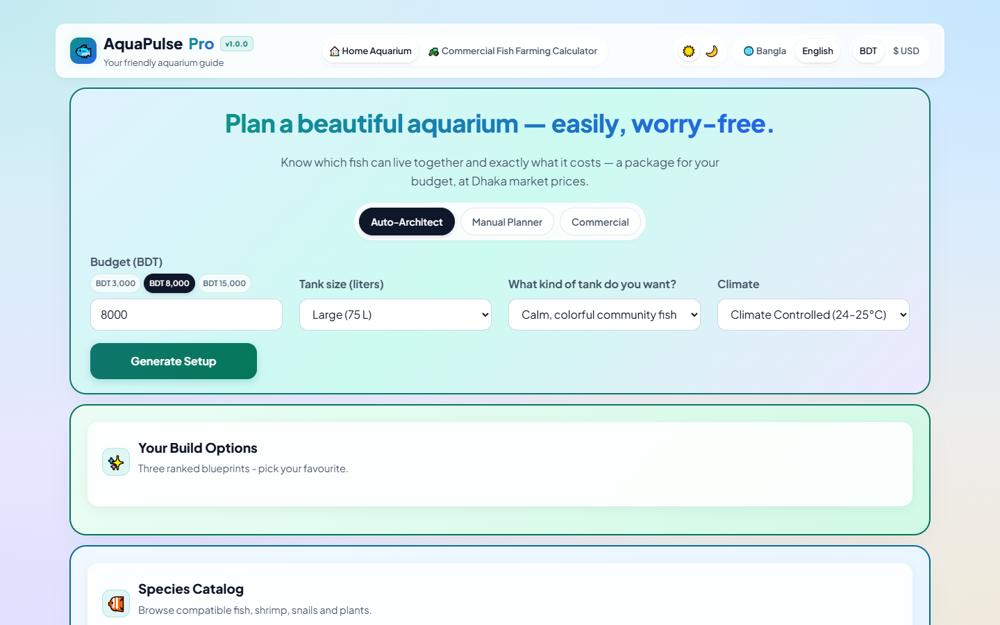
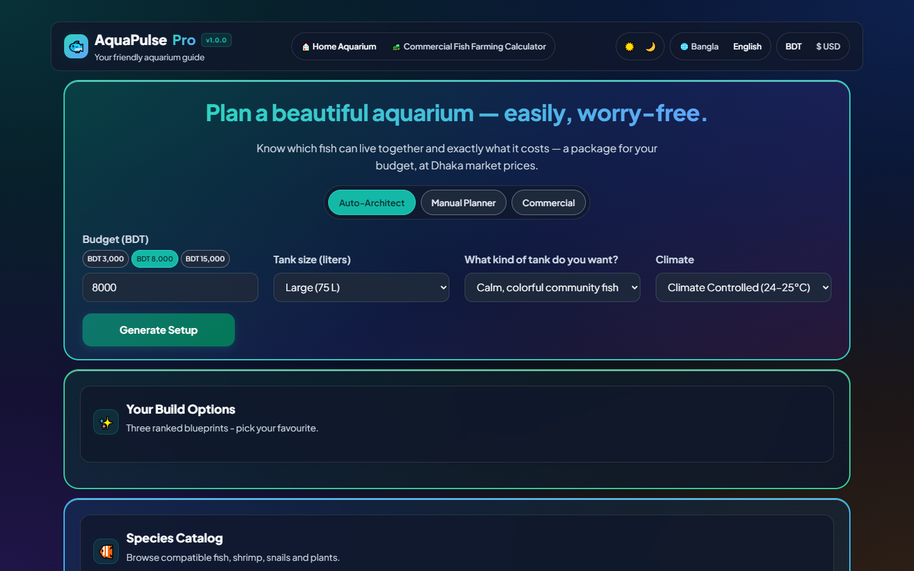

# AquaPulse Pro

[](https://github.com/NafisAfzal/aquapulse/stargazers)
[](LICENSE)
[](pyproject.toml)

A local aquarium planner with budget-based stocking suggestions, compatibility checks, BDT pricing, and printable care reports in English and Bangla.

## Preview

Real browser captures at 1440 x 900. Regenerate them with `npm run screenshots` while the app is running.

| Light | Dark |
| --- | --- |
|  |  |

## Why it exists

An aquarium plan needs to account for more than fish prices. Tank volume, filtration, schooling size, plants, water parameters, and room temperature all affect the setup. AquaPulse keeps these calculations together so you can compare a suggested build with one you assemble yourself.

The local-market goal is a useful shopping estimate for Bangladesh, including buyers visiting Dhaka's Katabon aquarium market. Hardware estimates live in `engine/pricing.py`; species prices live in the seeded catalog in `database.py`. BDT and USD use a configured conversion of **120 BDT per US dollar**, not a live exchange-rate feed. Prices are editable estimates, not current shop quotations. The repository does not include a dated Katabon price survey; check local prices before buying or claiming market calibration.

Compatibility uses explicit husbandry heuristics: aggression, predation, schooling requirements, swimming zones, and overlapping temperature, pH, and hardness ranges. The decisions are inspectable, but the rules are not an empirically validated guarantee of animal welfare. The inch-per-gallon capacity check and nitrogen forecast are simplified planning models. Actual water tests and species-specific care still matter.

## How it works

1. Enter a budget, tank volume, style goal, and climate. The deterministic Auto-Architect proposes ranked builds using compatibility, capacity, and cost checks. If the minimum hardware exceeds the budget, the result includes a warning.
2. Load a build or pick species manually. Analysis returns the tank configuration, bioload, compatibility issues, care suggestions, and itemized costs. A separate simulation estimates the next 30 days of nitrogen-cycle conditions.
3. Review the receipt and care sheet. Reports use active calculation results, with input defaults when values are missing. Print cards can span pages, while headings, rows, and totals stay together. Downloads include shopping items, specifications, and care instructions.

Commercial mode adds a separate aquaculture model with growth, feed, biofloc, and estimated return calculations. Its projections depend on the entered assumptions.

## Architecture

**FastAPI** exposes JSON routes and serves the frontend. **Pydantic** validates inputs and response models. Route handlers assemble the results of calculation services under `engine/`. **SQLite** holds the seeded catalog and saved builds and is created locally at runtime.

The vanilla frontend has no framework or bundler. `app.js` is organized into state, API, formatting, rendering, and event-handling sections rather than separate JavaScript modules. The multi-color Bento Grid layout uses section shells, CSS Grid, and theme tokens. Print-specific CSS removes editing controls and lets report data flow from page 1. Node and Playwright are development tools only.

```text
src/aquapulse/
|-- __main__.py                  # CLI server launcher
|-- api.py                       # HTTP routes and response assembly
|-- models.py                    # Validated inputs and domain contracts
|-- database.py                  # SQLite catalog, seed data, saved builds
|-- engine/                      # Calculation services
|   |-- optimizer.py             # Ranked setups and automatic corrections
|   |-- compatibility.py         # Species and environment checks
|   |-- bioload.py               # Capacity and filter turnover
|   |-- nitrogen_sim.py          # Daily nitrogen-cycle simulation
|   |-- pricing.py               # Hardware and livestock estimates
|   |-- climate.py               # Heating and cooling requirements
|   |-- disease_doctor.py        # Rule-based risk estimates
|   |-- breeding.py              # Breeding-condition estimates
|   `-- commercial_aquaculture.py
`-- static/
    |-- index.html               # Dashboard and report markup
    |-- app.js                   # State, rendering, localization
    `-- style.css                # Themes, responsive layout, print rules
tests/                           # API and calculation regression tests
scripts/                         # Browser checks, report tests, screenshots
docs/                            # Captures and implementation notes
```

## Run locally

Use Python 3.10 or later. These commands use PowerShell on Windows:

```powershell
git clone --branch ui-overhaul https://github.com/NafisAfzal/aquapulse.git
cd aquapulse
python -m venv .venv
.venv\Scripts\python -m pip install -e ".[dev]"
.\start.bat
```

Open [localhost:8000](http://127.0.0.1:8000). `start.bat` opens the browser and binds the server to localhost. Stop it with Ctrl+C. On macOS or Linux, use `.venv/bin/python` and launch with:

```sh
.venv/bin/python -m aquapulse --no-browser
```

Interactive API documentation is at [localhost:8000/docs](http://127.0.0.1:8000/docs). Useful routes include `POST /analyze-tank`, `POST /simulate-30-days`, `POST /optimize-setup`, and `POST /auto-fix-tank`.

This is a local application with no account or authorization layer. Review access controls and deployment settings before exposing it to a network.

## Tests and browser tools

```powershell
.venv\Scripts\python -m pytest tests/ -q
node --check src/aquapulse/static/app.js
```

The backend suite contains 116 tests. For optional browser tools, install Node.js 20 or later and npm:

```powershell
npm ci
npx playwright install chromium
npm run test:reports
# Keep the Python server running in another terminal:
npm run test:ui
npm run screenshots
```

The screenshot script writes the two preview PNGs and checks their signatures and dimensions. Browser scripts default to `http://127.0.0.1:8000`; pass another URL as an argument or set `AQUAPULSE_URL`. Set `PLAYWRIGHT_CHROMIUM_EXECUTABLE_PATH` to use an existing Chromium installation.

When changing a calculation, update focused tests and inspect its API consumers. When changing reports, check both languages, both currencies, and actual PDF pagination. Keep databases, credentials, virtual environments, and browser scratch files out of commits.

## License

[MIT](LICENSE). Copyright 2026 Nafis Afzal. You may use, study, modify, and redistribute the project under that license.
